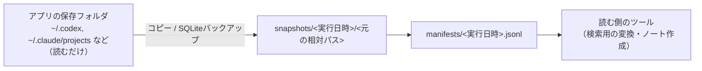

# Tkn GenAI Chat Archiver — 生成AIアプリのチャットログをRawのまま保管し続けるCLI

`tkn-genai-chat-archiver` は、Codex・Claude Code・Antigravity・VS Code などの生成AIアプリがローカルに保存したチャットログを、**バイト列を変えずに**別の場所へ定期的にコピーし、版を積み重ねて保管するCLIです。生成AIによる推論は一切使いません。

## 1. これは何か



- **コピーだけ**：元のファイルは消さず、変更もしません。アプリは再開や履歴表示に自分のログを使うためです。
- **版を積み重ねる**：同じ相対パスでもSHA-256が変われば、新しい版として追加します。保存済みの版は上書きも削除もしません。
- **拡張子で決めない**：対象はフォルダ単位で決め、アプリが置いたファイルをそのまま保存します。例えばCodexは古いセッションを自分で `.jsonl.zst` に圧縮しますが、その圧縮ファイルもそのまま保存します。
- **書き込み中は見送る**：最近更新されたファイルや、コピー中に変化したファイルは保存せず、次回に回します。ただし、アプリが一時ファイルに書いてから置き換えるファイル（例：Codexの `.codex-global-state.json`）は、待たずに「コピーの前後で変わっていないこと」だけを確かめて保存します。
- **SQLiteはバックアップ機能で取る**：WALモードのデータベースはファイルを単純にコピーすると内容が欠けることがあるため、SQLiteのバックアップ機能で整合したスナップショットを取り、その方法をmanifestに記録します。
- **中身を解析しない**：正規化・要約・秘密情報の伏せ字処理はしません。検索用の変換やノート生成は、このアーカイブを読む別のツールの役割です。

### 1.1. 対応アプリ

| profile | アプリ | 取得元の既定 | 主な取得範囲 |
| --- | --- | --- | --- |
| `codex` | Codex（CLI・デスクトップアプリ） | `~/.codex` | `sessions/`、`archived_sessions/`、チャット名の索引、アプリの状態 |
| `claude-code` | Claude Code（CLI・デスクトップのCodeタブ・IDE拡張） | `~/.claude` | `projects/` 全体（会話、サブエージェント、長いツール結果、タイトル、memory） |
| `antigravity` | Antigravity（IDE・CLI） | `~/.gemini` | `antigravity*/brain/`、`antigravity*/conversations/`（SQLite）など |
| `github-copilot` | GitHub Copilot（VS CodeのCopilot Chat・Copilot CLI） | `vscode`：`%APPDATA%\Code\User`、`cli`：`~/.copilot` | VS Codeの `chatSessions/`・`GitHub.copilot-chat/transcripts/` など、CLIの `session-state/` など |
| `vscode-chat` | 旧profile。VS Codeのチャットだけ（`github-copilot` に置き換え） | `%APPDATA%\Code\User` | `workspaceStorage/*/chatSessions/` など |

VS Codeのチャット欄の履歴は実質的にCopilot Chatの会話なので、`github-copilot` がVS Code側とCLI側をまとめて取ります。CodexやClaude CodeのVS Code拡張は、それぞれ `~/.codex`・`~/.claude` の会話を表示するだけなので、`codex`・`claude-code` で取れます。

WSL内のアプリは、`\\wsl.localhost\<distro>\home\<user>\.codex` を取得元とする別のtargetとして登録します。各profileの取得範囲と、取得しないものの理由は [対象アプリごとの取得範囲](docs/targets.md) を参照してください。

### 1.2. 対象外

- クラウドだけにある履歴（ChatGPT Web、claude.aiなど）の取得
- ログの解析・形式の統一・検索・要約
- 秘密情報の検出や伏せ字処理（Rawをそのまま保存するため、保存先の扱いに注意してください。[5. 安全性](#5-安全性)）

## 2. セットアップ

Python 3.11以上と [uv](https://docs.astral.sh/uv/) を使います。

```shell
cd C:\path\to\tkn_genai_chat_archiver
uv tool install .
tkn-genai-chat-archiver --help
tkn-genai-chat-archiver config init
```

### 2.1. 設定

設定ファイルは `~/.tkn/genai_chat_archiver/config.yaml` です。優先順位は、既定値 → ユーザー設定 → 作業フォルダの `.tkn/config.yaml` → `--config` → CLIオプションです。

```yaml
schema_version: "1.0.0"

logs_root: ~/.tkn/genai_chat_archiver/state/logs        # --log-dir で上書き
reports_root: ~/.tkn/genai_chat_archiver/state/reports  # --report-dir で上書き

defaults:
  settle_seconds: 600    # 最終更新からこの秒数が経っていないファイルは見送る
  read_only: true        # 保存した版と確定したmanifestに読み取り専用属性を付ける

targets:
  codex-my-pc-windows:
    profile: codex
    source_root: ~/.codex
    archive_root: C:\path\to\sources\softwares\Codex\chatLogs\my-pc-windows
    device_id: 2023 Example PC         # 機器の安定した識別名。フォルダ名とは別に記録する
    environment: windows
  codex-my-pc-wsl:
    profile: codex
    source_root: \\wsl.localhost\Ubuntu\home\example\.codex
    archive_root: C:\path\to\sources\softwares\Codex\chatLogs\my-pc-wsl
    device_id: 2023 Example PC
    environment: wsl:Ubuntu
    optional: true                     # 取得元が見つからなくても失敗にしない
  claude-code-my-pc-windows:
    profile: claude-code
    source_root: ~/.claude
    archive_root: C:\path\to\sources\softwares\Claude Code\chatLogs\my-pc-windows
    device_id: 2023 Example PC
    environment: windows
  github-copilot-my-pc-windows:
    profile: github-copilot
    source_roots:                      # 取得元が複数。保存先では vscode/・cli/ に分かれる
      vscode: "%APPDATA%\\Code\\User"
      cli: ~/.copilot
    archive_root: C:\path\to\sources\softwares\GitHub Copilot\chatLogs\my-pc-windows
    device_id: 2023 Example PC
    environment: windows
```

- `archive_root` は `<保存先>\<Software Name>\chatLogs\<Computer Name>` の形を想定しています。`source_id`（manifestに記録する取得環境のID）は、省略すると `archive_root` の末尾のフォルダ名になります。
- profileの取得範囲は `include` と `exclude` で置き換えられます。見送りの待ち時間を外すファイルは `settle_exempt`、同じフォルダにほかのファイルがあるときだけ取るファイルは `companion_include` で置き換えられます。実際に使われる一覧は `config show --target <id>` で確認できます。
- `source_roots` を使うprofile（`github-copilot`）では、取得元の追加（例：`vscode-insiders`）や削除ができます。取得元の一部が見つからない場合は警告だけで、残りを取ります。
- `enabled: false` のtargetは通常の実行では処理しません。`capture --dry-run --target <id>` を明示すれば、予定だけを確認できます。保存先のフォルダ（例：クラウドに同期するフォルダへのリンク）を用意してから有効にする場合に使います。
- 1つの `archive_root` には1つのtargetだけが書き込みます。複数のtargetで同じ保存先を指定すると、設定の検証で止まります。

## 3. 実行する

```shell
tkn-genai-chat-archiver capture --dry-run
tkn-genai-chat-archiver capture
tkn-genai-chat-archiver capture --target claude-code-my-pc-windows
tkn-genai-chat-archiver status
tkn-genai-chat-archiver verify --target codex-my-pc-windows
```

| コマンド | 内容 | 書き込み |
| --- | --- | --- |
| `capture` | 有効なtargetをそれぞれ走査し、新しい版を保存する。定期実行もこれを使う | アーカイブ、ログ、レポート |
| `capture --dry-run` | 保存する予定のファイルと件数を表示する | なし |
| `status` | targetごとの版の数・容量・最後の実行・中断した実行・取得元の有無を表示する | なし |
| `verify` | 保存済みの版を読み直し、manifestのSHA-256・サイズと照合する | なし |
| `legacy adopt` | `tkn-codex-chat-note-pipeline` が作った既存のCodexアーカイブを引き継ぐ（[移行手順](docs/migration-from-codex-chat-note-pipeline.md)） | マーカーとmanifestの追加のみ |
| `config init` / `show` / `validate` | 設定の作成・表示・検証 | `init` のみ |

主なオプション：

- `--target <id>`：対象を絞る（複数指定可）。省略すると有効なtargetをすべて処理します。`status`・`verify`・`--dry-run` では無効なtargetも指定できます。
- `--dry-run`：アーカイブ・ログ・レポート・状態ファイル・ロックを一切作らず、予定だけを表示します。取得元は読みますが変更しません。
- `--settle-seconds <秒>`：見送りの基準を一時的に変えます。手動で直後に取りたいときは `0` にします。
- `--rehash`：前回の状態を使わず、すべてのファイルのSHA-256を計算し直します。
- `--log-dir <dir>` / `--report-dir <dir>`：その実行のログとレポートの出力先を指定します。

### 3.1. 定期実行

Windowsのタスクスケジューラで毎日1回 `capture` を実行します。

| 項目 | 設定例 |
| --- | --- |
| タスク名・フォルダ | `TknGenAIChatArchiver_Daily`、ルート（`\`）。登録スクリプトの `-TaskName`・`-TaskPath` で変えられる |
| プログラム | インストール済み `tkn-genai-chat-archiver.exe` の絶対パス |
| 引数 | `capture --quiet`（設定ファイルを明示する場合は `--config "C:\path\to\config.yaml"` を足す） |
| 開始場所 | `~/.tkn/genai_chat_archiver`（関係のない `.tkn\config.yaml` を読まないため） |
| トリガー | 毎日1回（登録スクリプトの既定は02:00。`-At` で変えられる） |
| 実行ユーザー | アプリを使っているユーザー。WSLの取得元を読む場合は「ログオンしているときのみ実行」 |
| その他 | 実行できなかった分はすぐ実行する、多重実行しない、2時間で停止する |

[登録スクリプト](scripts/register-scheduled-task.ps1)は `-WhatIf` で確認できます。CLIをインストールしただけではタスクは登録されません。

## 4. 保存先の構成

```text
<archive-root>\                          例：...\softwares\Codex\chatLogs\my-pc-windows
├── .tkn-genai-chat-archive.json         このCLIの管理領域であることを示すマーカー
├── .pipeline.lock                       多重実行を防ぐロック
├── manifests\
│   ├── 20261102T030012+0900.jsonl       1回の実行で保存した版の記録（確定後は変更しない）
│   └── 20261103T030008+0900.jsonl.partial   実行中または中断した実行の記録
└── snapshots\
    └── 20261102T030012+0900\            その実行で新しく保存した版だけを置く
        └── sessions\2026\11\02\rollout-2026-11-02T08-15-00-<id>.jsonl
                                         ← 取得元からの相対パスとファイル名をそのまま使う
```

- 1回の実行で変わったファイルだけを、その実行の `snapshots\<実行日時>\` に、取得元と同じ相対パスで保存します。ファイル名は変えません。
- ある時点の状態は、その時点までの版を相対パスごとに新しい順に選べば復元できます。どの版がどこにあるかはmanifestに書かれています。
- 保存する版がなかった実行では、アーカイブに何も書きません（ログとレポートだけを残します）。

manifestの項目、版の決め方、読む側の守ること（例：保存したSQLiteは読み取り専用で開く）は [データ契約](docs/data-contract.md) を参照してください。

## 5. 安全性

- 元のファイルを開くのは読み取りだけです。移動・削除・属性の変更はしません。
- 保存は「同じフォルダの一時ファイルに書く → 書き込みを確定 → 上書きしない名前変更 → 読み直してSHA-256とサイズを照合 → manifestに1行追記」の順で行います。照合に失敗した版はmanifestに載せません。
- 保存済みの版とmanifestを、上書きも削除もしません。既定では読み取り専用属性も付けます。
- 取得元のシンボリックリンクやジャンクションはたどりません。
- 管理領域のマーカーがない空でないフォルダには書き込みません。
- チャットログには、ツールの出力に含まれたトークン・パスワード・個人情報がそのまま入ります。保存先の同期・バックアップの範囲は、その前提で決めてください。認証情報のファイル（例：`~/.codex/auth.json`、`~/.claude/.credentials.json`）は、どのprofileの取得範囲にも含めていません。
- Windowsの長いパス（260文字超）に対応します。ほかのツールで開く場合は、OSの長いパス設定が必要になることがあります。

## 6. 結果表示と終了コード

最終結果は標準出力に、既定では `key=value` の一覧、`--json` ではJSONで出力します。進捗・警告は標準エラー出力とログファイルに出します。`--full-output` を付けると、ファイルごとの詳細も表示します。

| 終了コード | 意味 |
| --- | --- |
| 0 | 成功（書き込み中で見送ったファイルがあっても成功） |
| 1 | いずれかのtargetで保存・照合に失敗した、取得元が見つからない（`optional` でない場合）、設定が不正 |
| 2 | 引数の誤り |
| 130 | 中断 |

## 7. 既存のCodexアーカイブからの移行

`tkn-codex-chat-note-pipeline` が作ったCodexのアーカイブは、中身を一切変えずに引き継げます。既存のファイルをそのまま最初の版としてmanifestに登録し、その後の版を `snapshots\` に追加します。手順は [移行手順](docs/migration-from-codex-chat-note-pipeline.md) を参照してください。

## 8. 開発・検証

```shell
uv sync --group dev
uv run python -m pytest
uv run python -m ruff check .
uv run python -m mypy src/tkn_genai_chat_archiver
```

テストは一時フォルダと合成したログを使います。実際のアプリのログは使いません。
